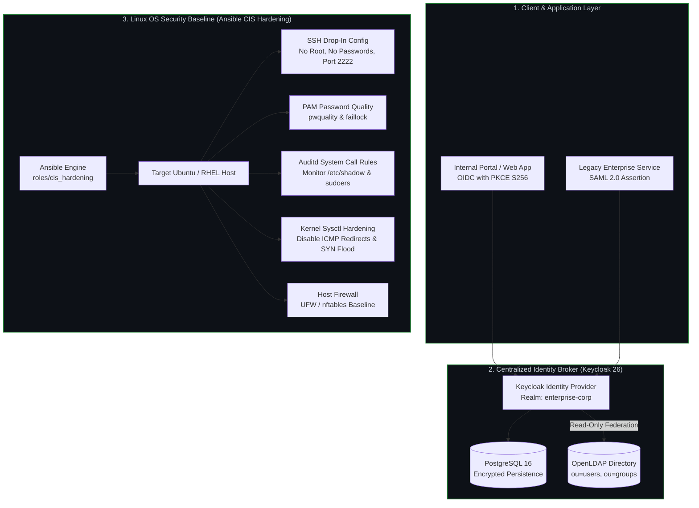

# Linux Hardening & Enterprise Identity Stack

[](https://github.com/huy8114644/linux-hardening-identity-stack/actions/workflows/ci.yml)
[](https://ansible.com)
[](https://keycloak.org)
[](https://www.cisecurity.org)
[](LICENSE)

Production-grade **Linux Infrastructure Security Hardening and Enterprise Identity Broker** combining an automated Ansible CIS Benchmark role with a containerized Keycloak 26 and OpenLDAP IAM governance stack.

---

## 🎯 Problem Statement & Core Value

Operating system misconfigurations and fragmented identity stores represent primary attack vectors for lateral movement, privilege escalation, and credential stuffing.

This repository provides an enterprise blueprint:
1. **Automated OS Hardening:** CIS-inspired baseline for Ubuntu and RHEL managing SSH drop-ins, PAM password complexity, kernel sysctls, and auditd system call auditing with fail-safe opt-in guards.
2. **Centralized Identity & Access Governance:** Keycloak 26 connected to an OpenLDAP user directory in read-only federation mode, preventing unauthorized directory tampering while enabling modern authentication.
3. **Enterprise SSO & Token Security:** Standardized OIDC with PKCE (S256) and SAML 2.0 integration ready to plug into internal developer portals and enterprise microservices.

---

## 🏛️ System & Identity Architecture



---

## 🔒 Security Capabilities & Control Matrix

| Component | Technology | Target Setting | Mitigation Impact |
|---|---|---|---|
| **SSH Hardening** | OpenSSH Drop-in | `PermitRootLogin no`, `PasswordAuthentication no` | Blocks brute-force and direct root compromise |
| **Audit Logging** | auditd rules | Watches on `/etc/shadow`, `/etc/sudoers`, `/etc/passwd` | Real-time audit trail of privilege changes |
| **Password Quality** | pam_pwquality | `minlen=14`, `deny=5`, 15-minute lockout | Enforces high-entropy credentials |
| **Unused Filesystems** | modprobe blacklist | Disables `cramfs`, `udf`, `squashfs` | Eliminates local privilege escalation bugs |
| **Identity Broker** | Keycloak 26.3 | OIDC PKCE (`S256`) + SAML 2.0 | Eliminates credential sharing and insecure flows |
| **Directory Federation** | OpenLDAP | Read-only LDAP sync with Group Mappers | Zero risk of identity provider writeback corrupting corporate LDAP |

---

## ⚙️ Environment Variables & Configuration

The Identity Stack (`identity/docker-compose/`) is configured via a generated `.env` file:

| Variable | Type | Default | Description |
|---|---|---|---|
| `DB_PASSWORD` | String | Generated | PostgreSQL database password for Keycloak persistence |
| `LDAP_ADMIN_PASSWORD` | String | Generated | OpenLDAP admin password (`cn=admin,dc=enterprise,dc=internal`) |
| `KEYCLOAK_ADMIN_PASSWORD` | String | Generated | Keycloak master administrator password |
| `KEYCLOAK_HTTP_PORT` | Integer | `8080` | Host port mapped to Keycloak service |
| `cis_profile` | String | `level1` | CIS Benchmark hardening profile (`level1`, `level2`) |
| `cis_apply_changes` | Boolean | `false` | Safety guard; must be explicitly `true` to mutate host settings |

---

## 🚀 Local Developer Quickstart

Standardized operational tasks are managed via the included `Makefile`:

```bash
# 1. Inspect all available Makefile targets
make help

# 2. Setup Python virtual environment and Ansible collections
make setup

# 3. Run static syntax and linting checks
make check

# 4. Execute Molecule isolated Docker test suite (Ubuntu 22.04)
make molecule

# 5. Bootstrap local secrets and start Identity stack (Keycloak + LDAP)
python3 identity/scripts/init_env.py
make identity-up

# 6. Verify Keycloak endpoints and LDAP synchronization
set -a; source identity/docker-compose/.env; set +a
python3 identity/scripts/reconcile_ldap.py
python3 identity/scripts/verify_discovery.py

# 7. Teardown Identity stack
make identity-down
```

---

## ☸️ Applying the OS Baseline to Real Hosts

```bash
# Dry-run check mode (no changes applied to host)
.venv/bin/ansible-playbook playbooks/site.yml --check --diff -e '{"cis_ssh_allow_groups":["sudo"]}'

# Apply hardening to staging target with explicit authorization
.venv/bin/ansible-playbook playbooks/site.yml --limit staging \
  -e '{"cis_apply_changes":true,"cis_ssh_allow_groups":["sudo"]}'
```

---

## 📄 License
This project is licensed under the MIT License - see the [LICENSE](LICENSE) file for details.
