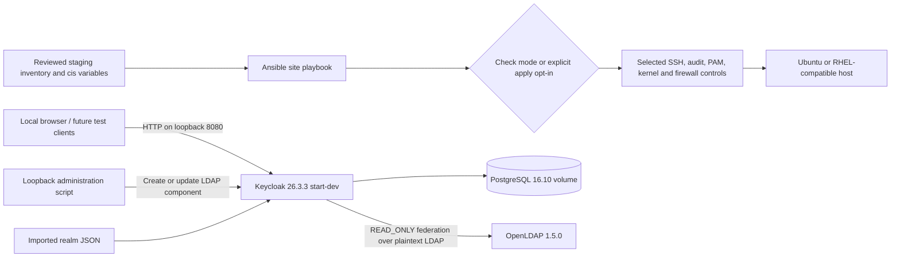
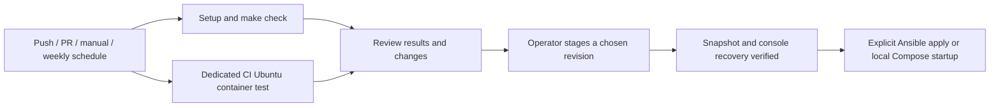

# Linux Hardening & Identity Stack

[](https://github.com/huy8114644/linux-hardening-identity-stack/actions/workflows/ci.yml)

An Ansible baseline for selected Linux controls and a local Keycloak/OpenLDAP identity lab. The project addresses two practical problems: reviewing repeatable host security settings before applying them, and exploring an identity broker backed by a directory. It is a learning and validation scaffold, not a certified CIS implementation or a production identity deployment.

## Architecture and data flow



The realm includes a public OIDC authorization-code client requiring PKCE S256, a department claim scope, and a placeholder SAML service provider. No application or sample user login is shipped. The reconciler configures user federation under `ou=people`; it does not configure a group mapper. PostgreSQL persistence uses a Docker volume; encryption at rest is not configured here. See [control scope](docs/controls.md) and [operations](docs/operations.md).

## Local quickstart

Requirements: Python 3.11+, Make, Docker with Compose v2, and network access to Python packages, Ansible collections and container registries. OpenLDAP's image is amd64 only; ARM needs emulation. Run from the repository root.

```bash
make                 # help only; never applies host settings
make setup           # create .venv, install development dependencies/collections
make lint
make test
make plan            # Ansible syntax and Compose config validation; no host contact
make scan            # local Gitleaks, or pinned Docker image; fails if unavailable
```

`make check` runs lint, offline tests and local configuration validation. `make molecule` additionally creates a privileged disposable Ubuntu 22.04 Docker target, tests convergence/idempotence and destroys it. Use a dedicated test daemon. It changes that container and does not establish host kernel enforcement or full CIS compliance.

To run the identity lab explicitly:

```bash
python3 identity/scripts/init_env.py  # creates mode-0600 .env; refuses overwrite
make identity-up
# Wait for http://127.0.0.1:8080 to become ready, then bootstrap federation:
set -a
source identity/docker-compose/.env
set +a
.venv/bin/python identity/scripts/reconcile_ldap.py
.venv/bin/python identity/scripts/verify_discovery.py
make identity-down                  # retains named volumes
```

Discovery verifies OIDC/SAML metadata only. Establish an LDAP user and complete OIDC PKCE and SAML SP login tests separately before claiming authentication works end to end. Do not publish generated credentials or command output containing them.

## Configuration

Identity values are generated into `identity/docker-compose/.env` and required by Compose. There are no usable default passwords.

| Variable | Default / source | Purpose |
| --- | --- | --- |
| `DB_PASSWORD` | Generated random value | Keycloak PostgreSQL password |
| `LDAP_ADMIN_PASSWORD` | Generated random value | Lab LDAP administrator and federation bind password |
| `KEYCLOAK_ADMIN_PASSWORD` | Generated random value | Keycloak bootstrap `admin` password |

Keycloak binds to `127.0.0.1:8080` in Compose; there is no HTTP-port environment override. The reconciler accepts `--url` for loopback HTTP; the discovery script uses port 8080 directly.

The full role inputs live in [defaults](roles/cis_hardening/defaults/main.yml). Principal settings are:

| Ansible variable | Default | Meaning |
| --- | --- | --- |
| `cis_apply_changes` | `false` | Must be true outside Ansible check mode |
| `cis_profile` | `level1` | `level1` or `level2`; selected settings, not complete benchmark profiles |
| `cis_ssh_allow_groups` | `[]` | Existing administrator groups; required when SSH management is enabled |
| `cis_ssh_port` | `22` | SSH listener port (2222 is only the Molecule example) |
| `cis_manage_ssh` / `cis_manage_auditd` / `cis_manage_kernel` | `true` | Enable selected control families |
| `cis_manage_pam` / `cis_manage_firewall` | `false` | Additional opt-in control families |
| `cis_firewall_allowed_tcp_ports` | `[22]` | Must include the SSH port when firewall is managed |
| `cis_container_mode` | `false` | Skips host kernel/firewall controls for container tests |
| `cis_pwquality_minlen` | `14` | Password quality setting when PAM is managed |
| `cis_faillock_deny` / `cis_faillock_unlock_time` | `5` / `900` seconds | RHEL faillock parameters; Ubuntu lockout is not configured |

## CI, delivery and rollback



GitHub Actions validates syntax, offline tests and Compose configuration, and runs Molecule in a separate job. GitLab has static validation and a privileged-runner integration job. Neither workflow deploys hosts or identity services; `make scan` is a local gate and is not currently wired into CI. A workflow file or badge alone is not evidence of a passing run.

For host deployment, replace the empty inventory with a staging target, verify a key-based administrator group, take a VM snapshot and configuration backups, and confirm console access. Then review a host-contacting Ansible check-mode diff:

```bash
.venv/bin/ansible-playbook playbooks/site.yml --limit staging --check --diff \
  -e '{"cis_ssh_allow_groups":["sudo"]}'
# Only after staging review and explicit operator authorization:
.venv/bin/ansible-playbook playbooks/site.yml --limit staging \
  -e '{"cis_apply_changes":true,"cis_ssh_allow_groups":["sudo"]}'
```

Check mode contacts the host and is not the offline `make plan`. Keep an existing SSH connection while verifying a new one. Rollback is manual: restore saved SSH/PAM/firewall/audit/sysctl/modprobe configuration and reload services, or restore the VM snapshot after lockout. The role has no automatic undo. RHEL VM behavior and host kernel controls need separate validation.

For the identity lab, `make identity-down` stops services while retaining volumes. Back up PostgreSQL and LDAP and test restoration before upgrades; checking out older code does not reverse database migrations. Realm import only initializes a missing realm, and changing `.env` does not rotate persisted passwords. Production delivery requires TLS, production Keycloak settings, a least-privilege LDAP bind, external secrets and a tested recovery process.

See [CONTRIBUTING.md](CONTRIBUTING.md) for review evidence. Licensed under [MIT](LICENSE).

[Local validation evidence](docs/local-validation.md) records checks and untested boundaries for this documentation revision. The secret scan uses directory mode and does not audit Git history.
